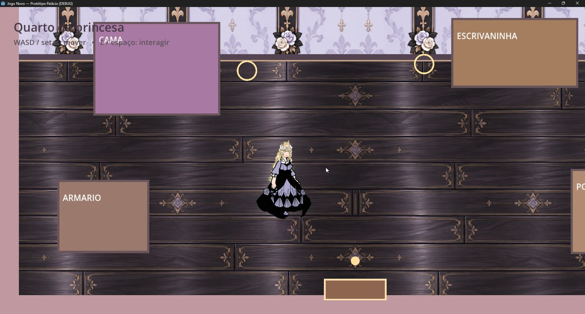

# M2 visual mínimo — chão e parede do quarto + câmera 1.30×

**Estado:** assets integrados; importação Godot 4.7.2 e smoke headless aprovados. Captura real da janela incluída. Revisão interativa de portas e limites da câmera ficou pendente; PR mantido como draft.

## Escopo e implementação
- Apenas o quarto recebe `floor_wood.jpg` e `wallpaper.jpg` em `assets/environments/bedroom/`.
- Corredor e jardim mantêm os fundos do protótipo; móveis continuam placeholders.
- A câmera segue a protagonista em zoom `1.30×`, com limites do mapa 0..1280 × 0..720. A HUD permanece em CanvasLayer.
- Nenhum sistema adicional ou mudança para Android foi feita.

## Verificações realizadas
- Godot **4.7.2 stable Windows** importou o projeto e os dois JPGs sem erro.
- `tests/smoke.gd` passou headless. O smoke verifica carregamento das texturas, zoom/limites, seguimento da câmera, animações, movimento, colisões, mensagens/janelas e percurso automatizado quarto → corredor → jardim → corredor → quarto.
- A janela real do jogo foi inspecionada: parede e piso texturizados, protagonista e placeholders aparecem no quarto com zoom 1.30×. Captura: [bedroom-start.jpg](validation/m2-bedroom/bedroom-start.jpg).

## Limitações desta validação
- Não foi concluída uma sessão manual com teclado para confirmar visualmente a travessia das portas e o comportamento da câmera junto a cada borda do mapa. O percurso foi coberto pelo smoke automatizado, não por observação manual.
- Não foi medido FPS, e controles/Android não foram testados.
- PR permanece draft até revisão visual manual completa no Windows.
